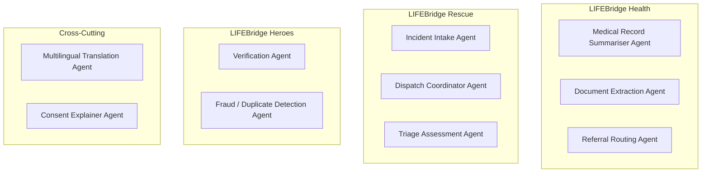
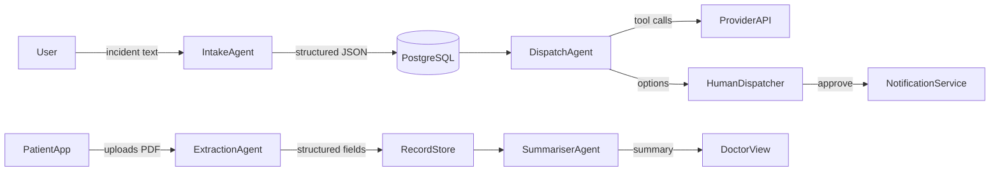

# LIFEBridge — AI Agents Design

## The 3-Module Agent Map



---

## Agent-by-Agent Breakdown

### 🏥 LIFEBridge Health Agents

#### 1. Medical Record Summariser Agent
- **Job:** Given a patient's authorised record timeline (consultations, prescriptions, lab results), produce a concise, human-readable clinical summary for the receiving doctor or specialist.
- **Input:** FHIR-structured or raw-text records the patient has consented to share.
- **Output:** Bullet-point summary — diagnoses, allergies, current medications, recent tests, flags.
- **Safety constraint:** Output is labelled "AI-assisted summary — verify against source records." Never infers diagnoses.

#### 2. Document Extraction Agent
- **Job:** Parse uploaded PDFs/images of lab reports, prescriptions, and discharge summaries; extract structured fields (test name, value, unit, reference range, date, ordering doctor).
- **Input:** Raw OCR text or image file.
- **Output:** Structured JSON → stored against the patient record with `source: ai_extracted, verified: false`.
- **Safety constraint:** Always flags fields with low confidence for human review.

#### 3. Referral Routing Agent
- **Job:** Given a diagnosis or specialist need, suggest which registered specialist types or departments are relevant — not which specific doctor to book.
- **Input:** Doctor's referral note or diagnosis keywords.
- **Output:** List of relevant specialties with reasoning. The patient/admin makes the actual booking.

---

### 🚨 LIFEBridge Rescue Agents

#### 4. Incident Intake Agent *(highest-value MVP agent)*
- **Job:** Turn a free-text or voice incident description into structured fields.
- **Example input:** `"there's been a bad crash near Silk Board, 2 people injured, one unconscious"`
- **Output:**
  ```json
  {
    "incident_type": "road_accident",
    "location_hint": "Silk Board, Bengaluru",
    "reported_casualties": 2,
    "severity_indicator": "high",
    "unconscious_reported": true,
    "language_detected": "en"
  }
  ```
- **Safety constraint:** Extracted severity is a *hint* to the dispatcher — never an auto-dispatch trigger.

#### 5. Dispatch Coordinator Agent *(multi-step, tool-using)*
- **Job:** An orchestrating agent that, given an incident ID, queries the provider directory tool, checks proximity data, drafts notifications to eligible providers, and tracks acknowledgement state — presenting options to the human dispatcher.
- **Tools it needs:**
  - `get_nearby_providers(lat, lng, radius_km)`
  - `send_notification(provider_id, incident_id)`
  - `get_incident_status(incident_id)`
- **Safety constraint:** Human dispatcher approves all actual dispatches. Agent surfaces options and automates data gathering only.

#### 6. Triage Assessment Agent *(assistive, not clinical)*
- **Job:** Given structured incident fields, return a plain-English situation summary and checklist of what information is still missing (e.g., "exact address not confirmed", "hospital capacity not yet verified").
- **Output:** Gaps checklist for the dispatcher — not a clinical triage score.

---

### 🌟 LIFEBridge Heroes Agents

#### 7. Verification Agent
- **Job:** Given a volunteer's submitted claim (incident ID, timestamp, description of assistance), cross-reference it against the incident timeline and flag inconsistencies for the human admin reviewer.
- **Output:** Verification report — consistent/inconsistent fields, confidence level, recommended admin action.

#### 8. Fraud / Duplicate Detection Agent
- **Job:** Detect if multiple volunteers are claiming the same action on the same incident, or if a report looks fabricated (timestamp outside incident window, location mismatch).
- **Output:** Risk flag with reasoning → admin reviews before points are awarded.

---

### 🌐 Cross-Cutting Agents

#### 9. Multilingual Translation Agent
- **Job:** Accept incident reports, record summaries, or volunteer submissions in Kannada, Hindi, Tamil, or Telugu and return English structured output — and conversely, translate responses back to the user's language.
- **Why critical for India:** Real-world use spans multiple regional languages.

#### 10. Consent Explainer Agent
- **Job:** When a specialist requests access to a patient's records, generate a plain-language explanation of *what* is being shared, *why*, and *for how long* — in the patient's preferred language. No legal advice; explanatory only.

---

## OpenAI Agents SDK vs Claude API — Where Each Fits

| Agent | OpenAI Agents SDK | Claude API (Anthropic) |
|---|---|---|
| **Incident Intake** | ✅ Strong — `structured_output` with Pydantic schemas gives guaranteed JSON extraction | ✅ Strong — Claude excels at following nuanced safety instructions and edge-case refusals |
| **Dispatch Coordinator** | ✅ Best fit — built-in tool calling, handoff between agents, tracing/observability out of the box | ⚠️ Possible but requires manual tool-loop orchestration |
| **Medical Record Summariser** | ✅ Good with long context | ✅ Best fit — Claude's 200k context window handles large FHIR bundles without chunking |
| **Document Extraction** | ✅ Vision + structured output via `gpt-4o` | ✅ Claude 3.5 Sonnet vision is comparable; better at following "low-confidence flag" instructions |
| **Referral Routing** | ✅ Fine | ✅ Fine |
| **Triage Assessment** | ✅ Fine | ✅ Better at nuanced "what's missing" reasoning |
| **Verification Agent** | ✅ Tool use to query DB records | ✅ Strong at logical consistency checking |
| **Fraud Detection** | ✅ Fine | ✅ Better at reasoning over subtle inconsistencies |
| **Multilingual Translation** | ✅ `gpt-4o` supports 50+ languages well | ✅ Claude also strong; slightly better at Indic scripts |
| **Consent Explainer** | ✅ Fine | ✅ Better — Claude is specifically trained for careful, non-misleading explanations |

---

## Recommended Architecture for the Hackathon



### Practical split for MVP

| Layer | Agent(s) | Rationale |
|---|---|---|
| **IBM watsonx** | Incident Intake, Document Extraction | Satisfies hackathon IBM AI requirement |
| **OpenAI Agents SDK** | Dispatch Coordinator | Multi-step tool orchestration, built-in tracing |
| **Claude API** | Medical Summariser, Consent Explainer | Long context (200k), safety-aware tone |

---

## Quickstart Code Patterns

### Incident Intake — OpenAI structured output

```python
from openai import OpenAI
from pydantic import BaseModel

class IncidentReport(BaseModel):
    incident_type: str
    location_hint: str
    reported_casualties: int
    severity_indicator: str  # low | medium | high
    unconscious_reported: bool

client = OpenAI()
response = client.beta.chat.completions.parse(
    model="gpt-4o",
    messages=[
        {
            "role": "system",
            "content": "Extract structured incident fields. Never infer severity beyond what is explicitly stated."
        },
        {"role": "user", "content": user_report_text}
    ],
    response_format=IncidentReport,
)
incident = response.choices[0].message.parsed
```

### Dispatch Coordinator — OpenAI Agents SDK

```python
from agents import Agent, function_tool, Runner

@function_tool
def get_nearby_providers(lat: float, lng: float, radius_km: float) -> list[dict]:
    # query PostGIS provider table
    ...

dispatch_agent = Agent(
    name="DispatchCoordinator",
    instructions=(
        "Surface nearby providers and draft notifications. "
        "Do not dispatch without human approval."
    ),
    tools=[get_nearby_providers, send_notification_draft],
)

result = await Runner.run(dispatch_agent, input=f"Incident {incident_id} at {location}")
```

### Medical Summariser — Claude API

```python
import anthropic

client = anthropic.Anthropic()
message = client.messages.create(
    model="claude-opus-4-5",
    max_tokens=1024,
    messages=[{
        "role": "user",
        "content": (
            "Summarise the following authorised patient records in plain language "
            "for the receiving clinician. Label this as AI-assisted. Do not diagnose.\n\n"
            f"{fhir_bundle_text}"
        )
    }]
)
```

---

## Safety Principles for All Agents

1. **No autonomous clinical decisions** — AI output is always labelled and routed through a human reviewer before affecting care or dispatch.
2. **Confidence flagging** — Extracted fields with low confidence are marked `verified: false` and surfaced for review.
3. **Audit trail** — Every AI call logs the model, version, input hash, and output alongside the record it influenced.
4. **Graceful degradation** — If an agent fails or returns low-confidence output, the workflow falls back to manual entry — it does not block the incident or consultation.
5. **No PII in prompts beyond necessity** — Minimum-necessary patient data is passed to external AI APIs; identifiers are pseudonymised where possible.
